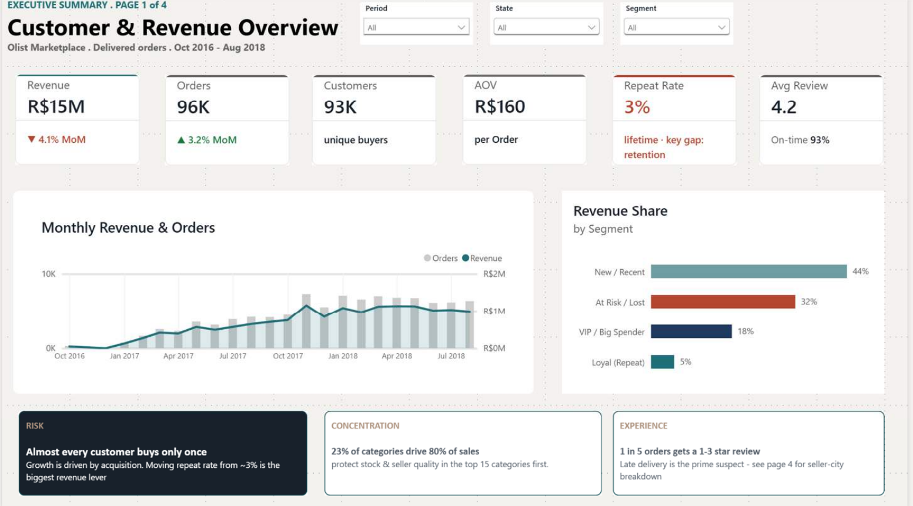
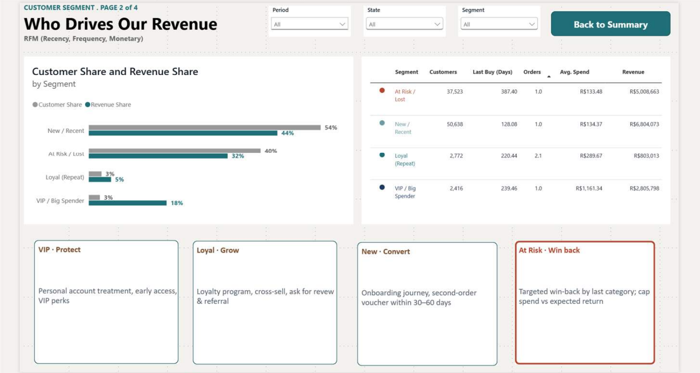
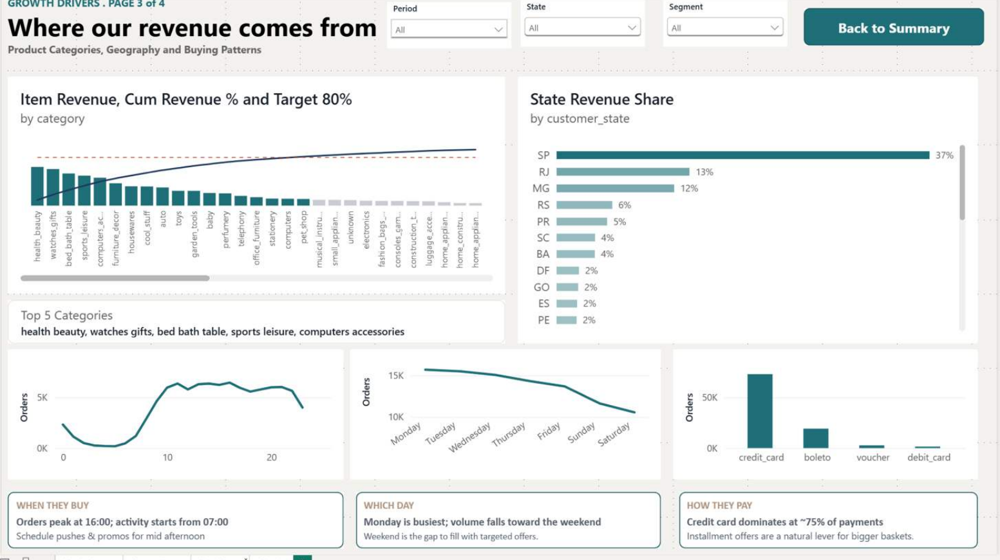
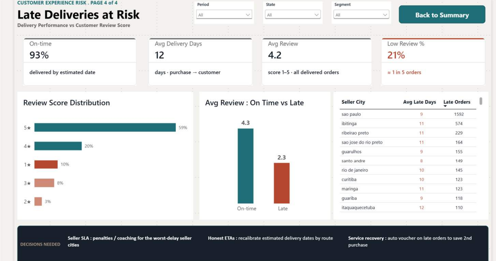

# Customer Segmentation & Revenue Dashboard (Olist, Power BI)

> Almost every customer buys once. Where does the revenue come from, and which customers are worth bringing back?

**Author:** Ahmad Zaki Irfan · [LinkedIn](https://linkedin.com/in/ahmad-zaki-irfan) · [GitHub](https://github.com/zakiirfan)
**Tools:** Power BI Desktop (DAX, Power Query), Python (Pandas, scikit-learn K-Means)
**Data:** [Olist Brazilian E-Commerce Public Dataset](https://www.kaggle.com/datasets/olistbr/brazilian-ecommerce) (Kaggle, CC BY-NC-SA 4.0). Delivered orders only, Sep 2016 to Aug 2018. All amounts are in Brazilian reais (R$).

## Dashboard (4 pages)






Open `pbix/Olist_Marketplace.pbix` in Power BI Desktop (Windows) for the interactive version, or see the PDF export in `docs/`.

## Business question

Olist is a marketplace with strong order growth but weak repeat purchasing. Which customer groups drive revenue, how much sits in customers who have gone quiet, and where is the best opportunity to raise repeat purchases?

## Headline numbers

| Metric | Value |
| --- | --- |
| Delivered orders | 96K |
| Unique customers | 93K |
| Revenue | R$ 15.4M |
| Average order value (AOV) | R$ 160 |
| Repeat rate (2+ orders) | 3% |
| Orders delivered on time | 93% |
| Average review score | 4.2 (21% of orders scored 3 or lower) |

## Segmentation method

1. **RFM per customer** (`customer_unique_id`): Recency (days since last purchase), Frequency (delivered orders), Monetary (total payment value).
2. **K-Means, k = 4**, on standardized RFM values (scikit-learn, `random_state=42`).
3. **Segments are named from each cluster's profile**: highest frequency = Loyal (Repeat); highest spend among the rest = VIP / Big Spender; highest recency (longest inactive) among the rest = At Risk / Lost; the remaining cluster = New / Recent.

`src/segment_customers.py` reproduces this from the raw Olist files. The segments used in the dashboard are in `data/processed/customer_segments.csv`; the script's output matches them within about 1% (for example New / Recent 50,720 vs 50,638 customers).

With only 3% of customers buying twice, frequency separates customers very little. Recency and spend drive most of the segmentation.

## Results

| Segment | Customers | Customer share | Last purchase (avg days ago) | Avg spend (R$) | Revenue (R$) | Revenue share |
| --- | --- | --- | --- | --- | --- | --- |
| New / Recent | 50,638 | 54% | 128 | 134 | 6.80M | 44% |
| At Risk / Lost | 37,523 | 40% | 387 | 133 | 5.01M | 32% |
| VIP / Big Spender | 2,416 | 3% | 239 | 1,161 | 2.81M | 18% |
| Loyal (Repeat) | 2,772 | 3% | 220 | 290 | 0.80M | 5% |

## Key findings

1. **3% of customers (VIP / Big Spender) generate 18% of revenue.** They spend about 8.7x more than a typical New / Recent customer (R$ 1,161 vs R$ 134), and almost all of them bought only once.
2. **40% of customers, 32% of revenue, have been inactive for a long time** (about 387 days since their last purchase on average).
3. **Repeat buyers (Loyal) spend about 2.2x more per customer** (R$ 290 vs R$ 134) but are only 3% of the base, so a small increase in repeat rate matters more than it looks.
4. **Late delivery hurts reviews.** Orders delivered late average a 2.3 review score versus 4.3 on time, and about 1 in 5 orders gets 3 stars or lower (page 4).
5. **Revenue is concentrated**: São Paulo state is 37% of revenue, and credit card is the dominant payment type (page 3).

## Recommended actions (per segment)

| Segment | Action |
| --- | --- |
| New / Recent | Onboarding journey and a second-order voucher within 30-60 days |
| VIP / Big Spender | Personal account treatment, early access, VIP perks |
| Loyal (Repeat) | Loyalty program, cross-sell, ask for reviews and referrals |
| At Risk / Lost | Targeted win-back by last purchased category, with spend capped against expected return |

Success would be measured by the share of New / Recent customers placing a second order within 90 days, compared with a holdout group.

## Data model (Power BI)

Tables: `fact_orders`, `fact_order_items`, `dim_customer` (segments), `dim_date`, `segment_summary`, and a `_Measures` table (Revenue, Orders, Customers, AOV, Revenue and Orders MoM %, Repeat Rate, Avg Review, Low Review %, On-time, Revenue / Customer Share, Cumulative Revenue % for the Pareto chart, and more).

## Limitations

- No marketing spend or acquisition channel in the data, so CAC and ROAS cannot be calculated here.
- Clusters are statistical groupings; segment names are my interpretation of each cluster's profile, and the number of clusters (4) was chosen for interpretability.
- The data ends in Aug 2018 and the first months (2016) are very small, so month-on-month changes near the edges should be read with care.
- The dataset is a public sample of one marketplace; findings are illustrative, not a forecast.

## Repo contents

```
├── pbix/                        Power BI report (open with Power BI Desktop, Windows)
├── docs/                        PDF export of the 4 dashboard pages
├── images/                      Dashboard page screenshots
├── src/segment_customers.py     RFM + K-Means segmentation script
├── data/processed/              Customer-level segments and segment summary
├── requirements.txt
└── README.md
```

Raw Olist files are not included; download them from Kaggle (see `data/README.md`).
